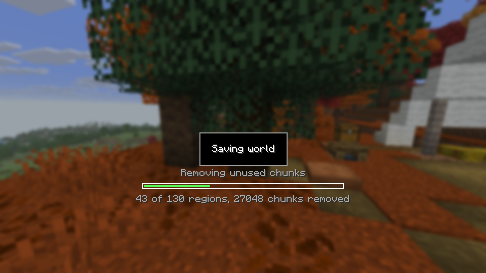
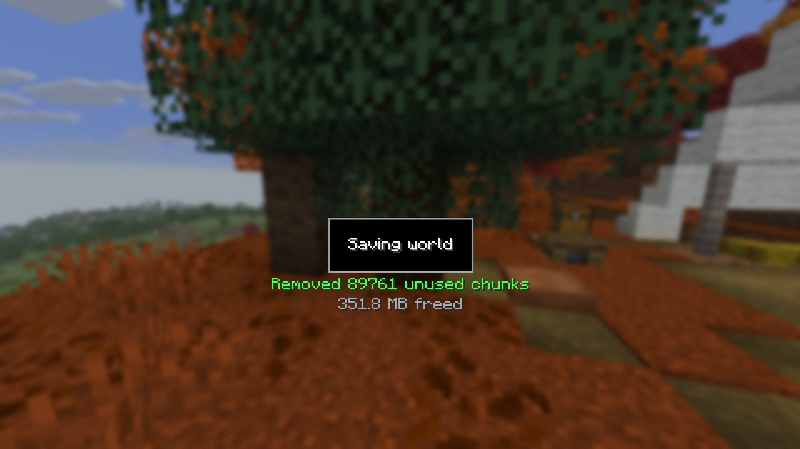

# Chunk Sweeper

Chunk Sweeper is a client-side Fabric mod that removes unused chunks from singleplayer worlds, making both the worlds and their backups much smaller. It works on its own, with nothing to set up. Unused chunks are swept away when you leave a world and left out of the backups made from the Edit World screen.

The chunk selection is a Java port of the [Thanos](https://github.com/aternosorg/thanos) library by Aternos.

| Removing unused chunks after "Save and Quit to Title" | Summary shown when it finishes |
| --- | --- |
|  |  |

---

### Downloads

Releases will be published on the [GitHub releases page](https://github.com/agustincantero/chunk-sweeper/releases). Until then, the mod can be built from sources (see below).

### Installation

Chunk Sweeper requires the following.

- Minecraft 26.2 or 26.3
- [Fabric Loader](https://fabricmc.net/use/) 0.20.1 or newer
- [Fabric API](https://modrinth.com/mod/fabric-api)

[Mod Menu](https://modrinth.com/mod/modmenu) is optional and adds an in-game settings screen. Put the jar in the `mods` folder of your game. The mod only runs on the client, so it is not needed on servers.

### How it works

A chunk counts as used when its `InhabitedTime` (the time players have spent near it) is greater than 0, or when it has a saved chunk ticket, for example from `/forceload`. Everything else, such as terrain that was only generated because a player flew past it, is removed. Minecraft generates it again if someone goes back there.

- **Prune on exit.** After "Save and Quit to Title", once the world has been saved and closed, unused chunks are removed from the world folder. The "Saving world" screen shows a progress bar while it runs and then the number of removed chunks and the freed space for a moment.
- **Pruned backups.** The "Make Backup" button in the Edit World screen creates the usual zip in the backups folder, but without unused chunks. The world itself is not modified. The backups that Minecraft makes before optimizing or recovering a world stay complete.

Region, entity and POI files are rewritten by copying the kept entries byte for byte, without recompressing them. Each file is written to a temporary file and then moved over the original, so an interrupted prune never leaves a half-written file.

### Configuration

With Mod Menu installed, the options can be changed in game from the mod list. They are stored in `config/chunksweeper.json`.

| Option | Default | Description |
| --- | --- | --- |
| `pruneOnWorldExit` | `true` | Remove unused chunks when a singleplayer world is closed. |
| `exitSummarySeconds` | `2` | How long the result stays on the "Saving world" screen after chunks were removed on exit. `0` disables it. |
| `overwriteBackups` | `false` | The "Make Backup" button keeps a single `<world folder>.zip` that is replaced every time, instead of adding a dated zip. The new zip is written to a temporary file first, so a failed backup never removes the previous one. |
| `inhabitedTimeThreshold` | `0` | Chunks are kept when their `InhabitedTime` (in ticks, 20 per second) is greater than this value. Only available in the config file. |

### Known Issues

Features that cross chunk borders, like trees, can look cut off if the chunk with one half is removed and the other is not. See [aternosorg/thanos#20](https://github.com/aternosorg/thanos/issues/20).

### Reporting Issues

Bugs, crashes and feature requests can be reported on the [issue tracker](https://github.com/agustincantero/chunk-sweeper/issues). For crashes, please include the `logs/latest.log` file of your game.

## Building from sources

Chunk Sweeper uses the [Gradle build tool](https://gradle.org/) through the included Gradle wrapper, which downloads the right version of Gradle by itself. Use `./gradlew` on macOS and Linux and `gradlew.bat` on Windows.

```bash
./gradlew build                # mod jar in build/libs, runs the unit tests
./gradlew test                 # unit tests against the Thanos test worlds, downloaded on the first run
./gradlew runClientGameTest    # opens the game, plays a world and checks the backup button and the prune on exit
```

`runClientGameTest` downloads Minecraft on the first run and opens a real game window with an offline development account, so it needs a display. It does not touch your own game or worlds.

### Build Requirements

- JDK 25
    - We recommend the [Eclipse Temurin](https://adoptium.net/) distribution.

### Other Minecraft versions

The jar is built against 26.3 and declares `>=26.2 <26.4` (`minecraft_dependency` in `gradle.properties`). To check another version, override the versions on the command line, as in this example.

```bash
./gradlew build runClientGameTest -Pminecraft_version=26.2 -Pfabric_api_version=0.161.0+26.2 -Pmodmenu_version=20.0.3 -Pminecraft_dependency=26.2
```

26.1 is not supported, since the screen rendering and toast APIs the mod uses changed in 26.2.

## License

The content of this repository is provided under the [MIT License](LICENSE) by Agustín Cantero. The chunk selection logic is derived from [Thanos](https://github.com/aternosorg/thanos) by Aternos GmbH, also released under the MIT License.
